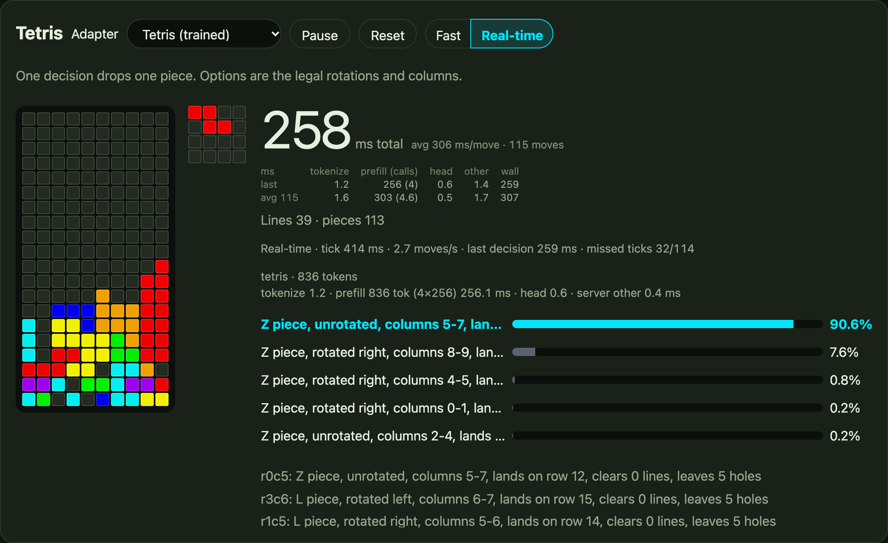
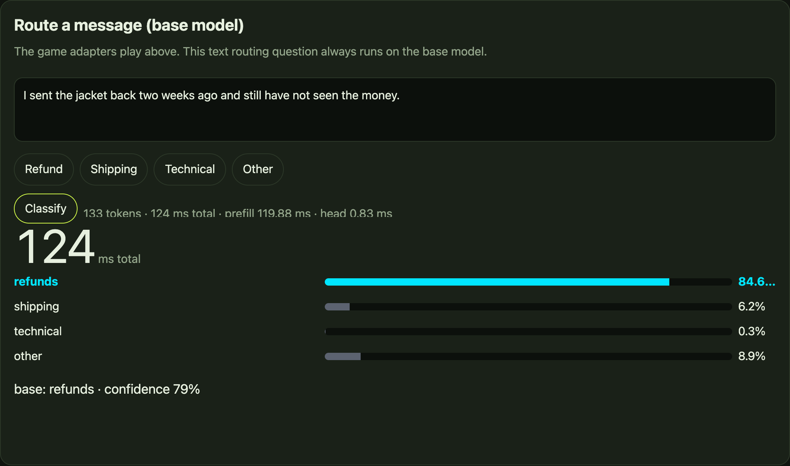
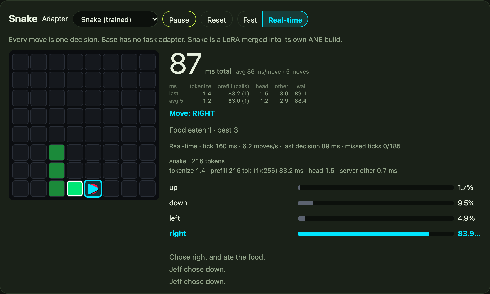

# System 1 ANE: millisecond decisions on the Apple Neural Engine

**System 1 ANE** runs small, task-specific **decision models** on the **Apple Neural Engine** through **Core AI**. "System 1" as in fast, intuitive decisions: one forward pass, no generated reasoning. You send a situation (`state`) and named options; a single prefill returns a calibrated probability for every option, in **milliseconds on Apple Silicon** (about 62-65 ms for a Snake or routing decision, about 0.3 s for a Tetris decision on an M5 Max). There is no generated text to parse.

The pipeline covers the whole loop: train a LoRA, merge it, export a prefill-only Core AI package, compile it for this Mac, and serve it through a `POST /v1/systemone` API and a browser demo (Snake, Tetris, and a text-routing panel).

## Which models

| Model | Status |
| --- | --- |
| **Jeff v1.3** ([mstrasser/jeff-base](https://huggingface.co/mstrasser/jeff-base), a fine-tune of Qwen3.5-0.8B) | **Primary model, verified.** Everything in this README (training, conversion, ANE placement, benchmarks, demos) was run and measured on Jeff. |
| Stock **Qwen3.5-0.8B** ([Qwen/Qwen3.5-0.8B](https://huggingface.co/Qwen/Qwen3.5-0.8B) / `unsloth/Qwen3.5-0.8B`) | **Optional, not the default: Jeff stays the default model and adapter in the serve path and the demo.** The Unsloth-trained stock Snake model (LoRA + Unsloth decision head, Colab A100-40GB, rank 16 / alpha 16, 3 epochs / 192 steps, seed 3407: held-out accuracy **28.5% → 87.1%** (223/256), reproducing 28.1% → 87.1%) can be merged, converted with `forge.py jeff-convert --prefill 304`, compiled and served as an extra adapter. It appears (as `snake-stock` in the demo dropdown) only when its build is passed with `--adapter snake-stock=<build>/coreai`; without that flag nothing changes. Verified locally on an M5 Max (9 October 2026): 7 of 7 packages `fully_ane`, 5/5 answers identical to Colab on the parity rows, **85.2%** held-out on the ANE (Colab fp32 87.1%), about 90.9 ms per decision with the Unsloth head on the host (about 8 ms) and about 85 ms with the head compiled to the ANE in fp16 (`CLEF_HEAD_BACKEND=ane`), against 63.7 ms for the Snake adapter shipped here (not controlled benchmarks). Same recipe on Jeff v1.3: 32.8% → 93.4%. Recipe, run order and caveats: [scripts/unsloth/README.md](scripts/unsloth/README.md); download: [`anemll/system1-base-unsloth`](https://huggingface.co/anemll/system1-base-unsloth), folder [`snake-stock-qwen3.5-unsloth/`](https://huggingface.co/anemll/system1-base-unsloth/tree/main/snake-stock-qwen3.5-unsloth) (`python scripts/download_model.py snake-stock-qwen3.5-unsloth`), [docs/RESULTS.md](docs/RESULTS.md); serving how-to: [Serving the Unsloth-trained stock Snake adapter](docs/SYSTEM1_ANE_SERVE.md#serving-the-unsloth-trained-stock-snake-adapter-optional). Training logs and weights are not in this repository. |
| Qwen3 0.8B-class base models (other than Qwen3.5-0.8B) | **Pending.** No run yet; nothing is verified on these, so please do not read this as "it works". Qwen3 0.8B-class: result pending. <!-- TODO(update after a Qwen3 0.8B-class (non-3.5) Snake run) --> |

Task adapters (LoRA plus a choice head) are trained with this repo's own trainer (`forge.py jeff-train-lora`, PyTorch on Apple MPS). Jeff and Qwen3.5-0.8B LoRA adapters are compatible with [Unsloth](https://unsloth.ai) training, which uses the same Qwen stack (see Credits). The Tetris and Snake adapters shipped here were trained **locally on an Apple M5 Max with PyTorch MPS** using this repo's code, not with Unsloth.

## Background

This checkout used to be a copy of [Anemll/anemll-forge](https://github.com/Anemll/anemll-forge) (Qwen3.8-27B toolkit). It is now a standalone tree for fast System 1 decision models. Shared Core AI graph/runtime files it still imports keep their original paths and are marked as originating from anemll-forge. See [docs/ORIGIN.md](docs/ORIGIN.md) and [HISTORY.md](HISTORY.md). It is the primary repository for ongoing development, including the Tetris training subproject; see the [workspace handoff](docs/WORKSPACE.md) for the migration scope and external artifacts.

Some internal names keep the Jeff name because Jeff is the model: `jeff_*` source files, `jeff-train-lora` / `jeff-convert` / `jeff-smoke`, the `JEFF_*` build/store/base-model environment variables, and the `anemll/jeff-ane-*-coreai` Hugging Face repos. The server is `system1-ane-serve` (`jeff-serve` and the old `JEFF_*` server variables still work as deprecated aliases).

## Results (Apple M5 Max)

Measured on an **Apple M5 Max**, macOS 27.2, ANE bonded compile mode 1, `p256_2k` FP16 packages. **Measured 7 Oct 2026; remeasurement pending.** Full tables: [docs/RESULTS.md](docs/RESULTS.md).

| What | Number |
| --- | --- |
| Base convert / compile | 27 s / 79 s; all six chunks + readout `fully_ane` |
| Snake / refund decision | ~62–65 ms total (~15.5 decisions/s), one 256-row prefill |
| Tetris decision (1430 tokens) | ~367 ms, 6 × 256-row calls (M5 Max) |
| Snake LoRA held-out accuracy | base 0.281 → adapter 0.594 (MPS, rank 16) |
| Tetris ANE lines / game | base 0.125 → adapter 7.38 (El-Tetris heuristic 13.50) |
| Tetris round-02 (Oct 8 continuation), 32 games, 150-piece cap | 30/32 reach cap, 149.75 pieces, 53.75 lines (teacher 57.69) |
| Published adapters (triage / tools / guard / spam) | argmax match vs merged PyTorch on every row that fit 2048 tokens |

You cannot reproduce ANE numbers on Linux. This tree was re-checked on an M5 Max (identical snake/tetris decisions vs the live server, demo page byte-identical). The Linux checkout only runs imports, `--help`, and unit tests.

The October 8 Tetris continuation reached the 150-piece cap in **30/32** ANE benchmark games (mean **149.75 pieces, 53.75 lines**). This is a repeated benchmark on previously evaluated seeds. See the [training report](projects/tetris_training/README.md#completed-overnight-results) for checkpoint provenance and limitations.

## Demo screenshots

Screenshots of the browser demo served by `system1-ane-serve` on an M5 Max (every move is one Jeff decision on the ANE). Each game has a **Fast** mode (the next move is requested as soon as a decision arrives) and a **Real-time** mode (a fixed tick, with the next decision requested ahead; the panel shows missed ticks). The Snake and Tetris adapters are selected by default when the server loads them.

**Tetris** — Tetris adapter (October 8 round 02) in Real-time mode, in the middle of a game, with the per-option probabilities for the current piece (258 ms for this ~840-token decision, about 306 ms/move on average). This is a single illustrative game; the results above come from the 32-seed benchmark, and browser games vary.



**Text routing** — the base model classifying a support message into one of four options in one forward pass (124 ms total here, including tokenization).



**Snake** — the Snake adapter in Real-time mode. It is a weak policy (about 0.25 food per game in [docs/RESULTS.md](docs/RESULTS.md)); the demo shows the mechanics (one decision per move, ~86 ms here), not strong play.



## Requirements

- **Apple Silicon Mac** (measured on **M5 Max**; M5 family uses bonded compile mode 1, M6+ uses mode 2)
- **macOS with Core AI** (the conversion SDK and `coreai.runtime`; the Swift bridge builds with Xcode / `xcrun swiftc`)
- **Python 3.11+** host venv (transformers, torch) for train / tokenize / `forge.py`
- **Core AI SDK Python** (`COREAI_PYTHON`) for convert, compile, and `system1-ane-serve` (it loads the ANE packages). **Set `COREAI_PYTHON` whenever you run `forge.py` from the host venv** — otherwise those commands would use the host interpreter, which has no Core AI.

Model weights are not in Git. `scripts/download_model.py` fetches the prebuilt Core AI demo builds from Hugging Face; training uses a local `jeff-base` v1.3 checkpoint.

## Quick start (prebuilt models)

Three demo builds are published as exported Core AI packages (1.5 GB each, base 3.2 GB; see [docs/MODELS.md](docs/MODELS.md)):

| Name | Hugging Face | Used for |
| --- | --- | --- |
| `tetris` | [anemll/jeff-ane-tetris-coreai](https://huggingface.co/anemll/jeff-ane-tetris-coreai) | Tetris tab (October 8 overnight model, round 02) |
| `snake` | [anemll/jeff-ane-snake-coreai](https://huggingface.co/anemll/jeff-ane-snake-coreai) | Snake tab |
| `base` | [anemll/jeff-ane-base-coreai](https://huggingface.co/anemll/jeff-ane-base-coreai) | jeff-base v1.3: routing panel and the server's `--model` |
| `snake-stock-qwen3.5-unsloth` (optional extra, not in the default set) | [anemll/system1-base-unsloth](https://huggingface.co/anemll/system1-base-unsloth), folder [`snake-stock-qwen3.5-unsloth/`](https://huggingface.co/anemll/system1-base-unsloth/tree/main/snake-stock-qwen3.5-unsloth) | Unsloth-trained stock Qwen3.5-0.8B Snake adapter, served as `--adapter snake-stock=<build>/coreai` ([how-to](docs/SYSTEM1_ANE_SERVE.md#serving-the-unsloth-trained-stock-snake-adapter-optional)). Jeff remains the default. |

```sh
git clone https://github.com/Anemll/system1-ane.git
cd system1-ane

# 1. Host venv (tokenizer, forge.py, download, tests)
python3.11 -m venv .venv
source .venv/bin/activate
python -m pip install --upgrade pip
python -m pip install -r requirements-inference.txt

# 2. Core AI SDK interpreter (loads/compiles ANE packages). Required whenever forge.py runs from the host venv.
export COREAI_PYTHON=/path/to/coreai-sdk/bin/python
bash coreai/swift_bridge/build.sh     # writes coreai/swift_bridge/libcoreai_bridge.dylib (default loader path)

# 3. Download the builds (default ~/Models/jeff-ane; override with JEFF_MODELS_DIR)
export JEFF_MODELS_DIR="${JEFF_MODELS_DIR:-$HOME/Models/jeff-ane}"
python scripts/download_model.py tetris snake base

# 4. Compile once per Mac (cache is keyed by macOS build and COREAI_PYTHON)
for m in base snake tetris; do python forge.py compile --build "$JEFF_MODELS_DIR/$m/coreai"; done

# 5. Serve the demo
export SYSTEM1_ANE_QUEUE_MS=1500   # live demo: wait this long before 529 on a busy server
python forge.py system1-ane-serve \
  --model "$JEFF_MODELS_DIR/base/model" \
  --build "$JEFF_MODELS_DIR/base/coreai" \
  --adapter snake="$JEFF_MODELS_DIR/snake/coreai" \
  --adapter tetris="$JEFF_MODELS_DIR/tetris/coreai" \
  --host 127.0.0.1 --port 8787
```

Open http://127.0.0.1:8787/ — Snake and Tetris, each move one Jeff decision, plus a routing panel on the base build.

```sh
# Without --adapter the request hits the base model, even when snake/tetris are loaded.
python examples/decide_http.py --url http://127.0.0.1:8787 --game snake --adapter snake
python examples/decide_http.py --url http://127.0.0.1:8787 --game tetris --adapter tetris
```

Already have the October 8 training output locally? Its `build/` directory has the same `coreai/` + `model/` layout,
so you can skip the Tetris download:

```sh
JEFF_TETRIS_BUILD="${JEFF_TETRIS_BUILD:-$HOME/Models/jeff-tetris-training/overnight-20261008/round-02/build}"
# then use --adapter tetris="$JEFF_TETRIS_BUILD/coreai"
```

Notebooks in [`notebooks/`](notebooks/) walk through the same steps: download + ANE inference, the Tetris model, and Snake.

## Build your own

Training and conversion need a local base-model checkpoint directory. The verified example is Jeff v1.3 ([mstrasser/jeff-base](https://huggingface.co/mstrasser/jeff-base), revision `v1.3`); the optional Unsloth-trained stock Qwen3.5-0.8B Snake adapter is verified as an extra adapter (see "Which models"); other base models are not:

```sh
# BASE_MODEL: path to the base checkpoint. The example default is Jeff v1.3; the code reads the
# JEFF_BASE_MODEL environment variable (kept as is), so setting that still works.
BASE_MODEL="${JEFF_BASE_MODEL:-$HOME/Models/jeff/jeff-base-v1.3}"
```

### 1. Train a LoRA

```sh
python forge.py jeff-train-lora \
  --model "$BASE_MODEL" --output "$HOME/Models/jeff-snake" --task snake
# Tetris: see projects/tetris_training/README.md (dataset, overnight continuation)
```

Writes `adapter/`, `merged/` (full checkpoint), and `report.json`. Training is PyTorch (MPS / CUDA / CPU). It does not load Core AI.

### 2. Merge a published PEFT adapter (optional)

```sh
python scripts/jeff_peft_merge.py \
  --model "$BASE_MODEL" \
  --adapter "$HOME/Models/jeff/adapters/jeff-adapter-triage" \
  --output "$HOME/Models/jeff-published/triage"
```

### 3. Core AI export

```sh
python forge.py jeff-convert \
  --model "$HOME/Models/jeff-snake/merged" \
  --output "$HOME/Models/jeff-coreai/adapters/snake"
# Base: --model "$BASE_MODEL" --output "$HOME/Models/jeff-coreai"
```

### 4. Compile and serve

```sh
python forge.py compile --build "$HOME/Models/jeff-coreai/adapters/snake/coreai"
python forge.py system1-ane-serve --model "$BASE_MODEL" --build "$HOME/Models/jeff-coreai/coreai" \
  --adapter snake="$HOME/Models/jeff-coreai/adapters/snake/coreai" --port 8787
```

Convert, compile, and serve must use the same `COREAI_PYTHON`.

## CLI

`forge.py` is the entry point (the live server is launched as `python forge.py system1-ane-serve ...`):

| Command | What it does |
| --- | --- |
| `jeff-train-lora` | Snake / Tetris (or JSONL) LoRA + merge |
| `jeff-convert` | Prefill-only Core AI export |
| `compile` | Specialize packages for this Mac's ANE |
| `system1-ane-serve` | `POST /v1/systemone` + browser demo |
| `jeff-smoke` | Host or ANE prefill + readout parity |
| `doctor` | Environment report (no model load) |

`--help` works on Linux. Convert / compile / serve without `--dry-run` require macOS.

## Documentation

- [Tetris training](projects/tetris_training/README.md) — teacher/recovery data, LoRA plus readout, gameplay evaluation and bounded continuation
- [Workspace handoff](docs/WORKSPACE.md) — primary checkout, imported work and external dependencies
- [Architecture](docs/ARCHITECTURE.md) — checkpoint, readout, prefill-only packages, prefix hook
- [Build / export pipeline](docs/PIPELINE.md) — train → merge → convert → compile → serve
- [Server API](docs/SYSTEM1_ANE_SERVE.md) — endpoints, request/response, `SYSTEM1_ANE_PREFILL`, `SYSTEM1_ANE_QUEUE_MS`
- [Adapters](docs/ADAPTERS.md) — Snake, Tetris, published PEFT (guard / spam / tools / triage)
- [Measured results](docs/RESULTS.md) — M5 Max timings and accuracy
- [Research note](docs/research/JEFF_DECISION_ANE.md) — Path B convert, FP16 parity, INT8
- [HISTORY](HISTORY.md) / [CHANGELOG](CHANGELOG.md) — how Jeff evolved (anemll-forge PRs #6–#10)

## Samples

- [`examples/decide_http.py`](examples/decide_http.py) — one Snake or Tetris decision against a running server
- [`examples/runtime_prompt.py`](examples/runtime_prompt.py) — one prompt through `JeffCoreAI` (`$COREAI_PYTHON` + `TOKENIZER_PYTHON`; no transformers in the Core AI venv)

## Credits

- **Jeff v1.3** by [mstrasser](https://huggingface.co/mstrasser) ([mstrasser/jeff-base](https://huggingface.co/mstrasser/jeff-base), Apache-2.0), a fine-tune of **Qwen3.5-0.8B** by the Qwen Team, Alibaba Cloud ([Qwen/Qwen3.5-0.8B](https://huggingface.co/Qwen/Qwen3.5-0.8B), Apache-2.0).
- **Teacher heuristic:** El-Tetris by Islam El-Ashi (2011), an improvement on Pierre Dellacherie's algorithm — <https://imake.ninja/el-tetris-an-improvement-on-pierre-dellacheries-algorithm/>. It labels the Tetris training data and is the benchmark's reference player.
- **Dependencies:** PyTorch, Transformers, safetensors, tokenizers, Hugging Face Hub, coremltools and the Apple Core AI packages are listed in [`requirements-inference.txt`](requirements-inference.txt) and [`requirements-conversion.txt`](requirements-conversion.txt).
- **Unsloth:** thanks to the [Unsloth](https://unsloth.ai) team. Jeff / Qwen3.5-0.8B LoRA adapters are compatible with Unsloth training: a Snake LoRA run with Unsloth on Colab (A100 and T4) was verified, and the resulting stock-base adapter can be served as an optional extra adapter ([how-to](docs/SYSTEM1_ANE_SERVE.md#serving-the-unsloth-trained-stock-snake-adapter-optional)). The shipped Snake and Tetris adapters were **not** trained with Unsloth code or its runtime; they were trained locally on an Apple M5 Max with PyTorch MPS. Anemll's training code is its own, and LoRA itself is standard practice, so it needs no special credit. The head training workflow was adopted from Unsloth's notebook. Useful guides: [Unsloth LoRA fine-tuning hyperparameters guide](https://unsloth.ai/docs/get-started/fine-tuning-llms-guide/lora-hyperparameters-guide), [Unsloth Qwen3: how to run & fine-tune](https://unsloth.ai/docs/models/tutorials/qwen3-how-to-run-and-fine-tune), and [Unsloth Qwen3.8 training](https://unsloth.ai/docs/models/qwen3.8/train).

## License

MIT ([LICENSE](LICENSE)). Jeff base and published adapters are Apache-2.0 from their authors. The Qwen3.5-0.8B backbone is from the Qwen Team / Alibaba Cloud (Apache-2.0).
